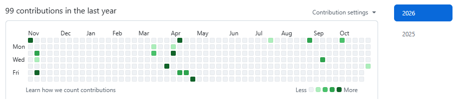
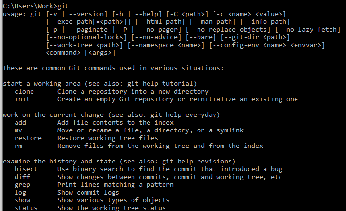
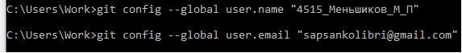
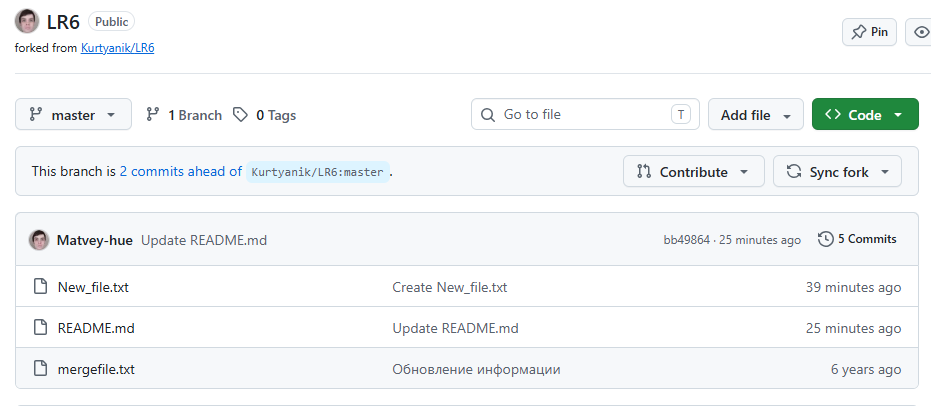
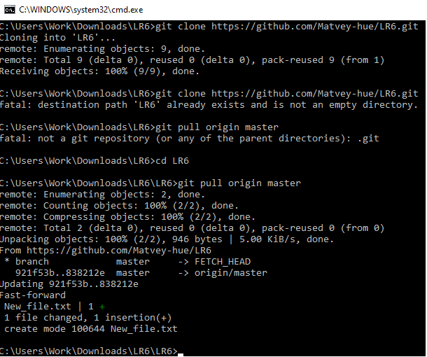
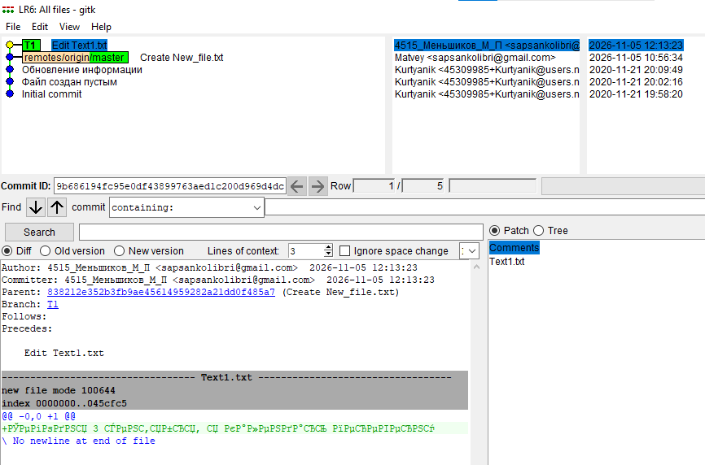
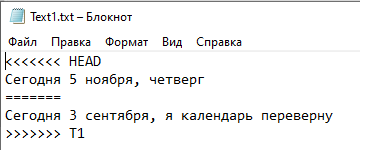
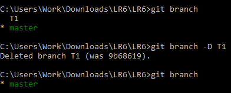

# LR6
Лабораторная работа №6

Система контроля версий

Цель лабораторной работы

Изучение базовых возможностей системы управления версиями, опыт работы с Git Api, опыт работы с локальным и удаленным репозиторием.

Ход работы

1. Аккаунт на сайте GitHub уже был создан в ходе выполнения лабораторной работы. Активность за последний год приведена ниже.
<p align="center">
  
</p>

2. Снимок экрана ниже подтверждает, что Git был успешно установлен на локальный компьютер.  

<p align="center">
  
</p>

3. С помощью команды git config в консоли был настроен git-клиент, где были введены имя пользователя и email.

<p align="center">
  
</p>

4. Через интерфейс GitHub был добавлен новый файл New_file.txt.

<p align="center">
  
</p>

5. Изменения в локальный репозиторий (с файлом New_file.txt) были подтянуты с помощью команды git pull.

<p align="center">
  
</p>

6. В локальном репозитории был создан отчёт в файле README.md

7. На рисунке ниже представлена история операций для каждой из веток. Для этого использовался интерфейс gitk.

<p align="center">
  
</p>

8. Был создан файл Text1.txt и записан туда один текст. Затем изменения были сохранены в ветке T1. После возврата в ветку master был вновь создан файл Text1.txt и записан в него другой текст. Также в ветку master были сохранены изображения в папке Images/.
Затем было выполнено слияние веток (git merge) и произошёл КОНФЛИКТ. Он представлен на рисунке ниже. Затем он был разрешён в пользу одного текста.

<p align="center">
  
</p>

9. После объединения ветка T1 была удалена. Результат представлен ниже.

<p align="center">
  
</p>

10. Лог команд
    
```Shell
git status
git branch
git switch
git branch -D
git log
git revert
git reset --hard
git push
git config
git add
git restore
git merge
git remote
git clone
git pull
```

11. История коммитов

```Shell
caa8c79 - Thu Nov 5 12:20:28 2026 +0300 | 4515_Меньшиков_М_П: Edit Base files
985b1b3 - Thu Nov 5 12:18:25 2026 +0300 | 4515_Меньшиков_М_П: Text1.txt
838212e - Thu Nov 5 10:56:34 2026 +0300 | Matvey: Create New_file.txt
921f53b - Sat Nov 21 20:09:49 2020 +0300 | Kurtyanik: Обновление информации
c08a654 - Sat Nov 21 20:02:16 2020 +0300 | Kurtyanik: Файл создан пустым
3c6e913 - Sat Nov 21 19:58:20 2020 +0300 | Kurtyanik: Initial commit
```

Выводы

В ходе выполнения лабораторной работы были изучены возможности системы управления версиями, получен опыт работы с Git Api, опыт работы с локальным и удаленным репозиторием.
